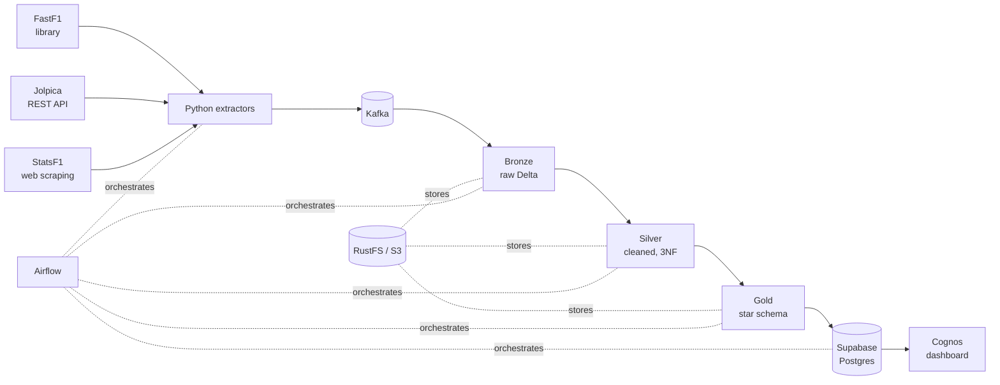
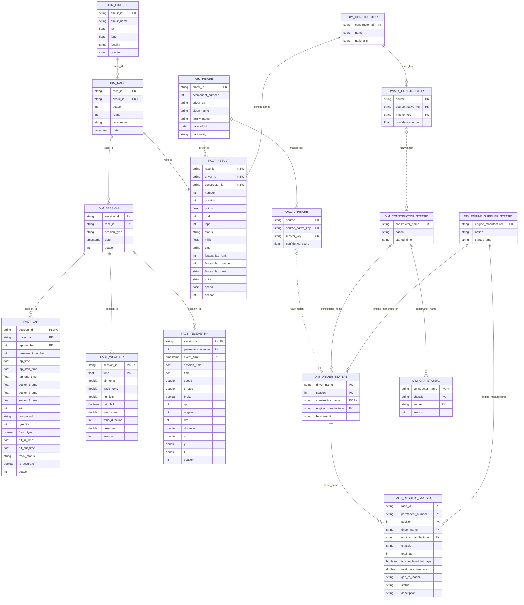
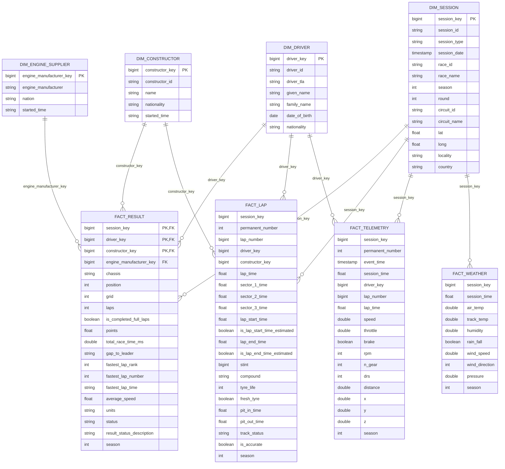

<h1 align="center">
  <br>
  
  <br>
  F1 Data Pipeline
  <br>
</h1>

<h4 align="center">A Formula 1 data platform: three sources, Kafka streaming, a Delta Lake Medallion architecture, a star-schema warehouse and a Cognos dashboard.</h4>

<p align="center">
  
  
  
  
  
  
  
  
</p>

This project collects Formula 1 data from **three independent sources**: [FastF1](https://docs.fastf1.dev/), the [Jolpica F1 API](https://github.com/jolpica/jolpica-f1) and [StatsF1](https://www.statsf1.com/), streams it through Kafka, and refines it through Bronze, Silver and Gold layers stored as Delta tables on S3-compatible storage. The Gold star schema is loaded into a Postgres database (Supabase) and visualised in an IBM Cognos Analytics dashboard. The whole stack runs locally with Docker Compose and is orchestrated by Apache Airflow.

<p align="center">
  
</p>

## Table of Contents

- [Background](#background)
  - [Data Sources](#data-sources)
  - [Highlights](#highlights)
- [Install](#install)
  - [Database Setup](#database-setup)
- [Usage](#usage)
- [Architecture](#architecture)
- [Data Model](#data-model)
  - [Silver layer](#silver-layer)
  - [Gold layer](#gold-layer)
- [Dashboard](#dashboard)
- [Project Structure](#project-structure)
- [Maintainers](#maintainers)
- [Contributing](#contributing)
- [License](#license)

## Background

Driven by a passion for F1 and curiosity about driver telemetry—braking, cornering, and throttle control—I built this Data Engineering project to unify fragmented F1 data into a single, analysis-ready model, demonstrating batch/streaming ingestion, entity resolution, dimensional modeling, and orchestration. Building this made me feel truly connected to the F1 community. I don't plan to stop here—I will continue expanding the platform and integrating advanced models to bring even deeper insights to F1 fans in the future.
### Data Sources

| Source | Access method | What it provides | Used for |
| ------ | ------------- | ---------------- | -------- |
| [**FastF1**](https://docs.fastf1.dev/) | Python library | Lap timing, tyre data, weather and high-frequency car telemetry (speed, throttle, brake, RPM, gear, DRS, X/Y/Z position) | `FACT_LAP`, `FACT_WEATHER`, `FACT_TELEMETRY` |
| [**Jolpica F1 API**](https://github.com/jolpica/jolpica-f1) | REST API | Race calendar, circuits, drivers, constructors and official race results | Master (golden) records for races, sessions, drivers and constructors, plus `FACT_RESULT` |
| [**StatsF1**](https://www.statsf1.com/) | Web scraping (BeautifulSoup + lxml) | Constructors, engine suppliers, cars (chassis / engine), driver line-ups and results | `DIM_ENGINE_SUPPLIER`, chassis, and enrichment of constructors and results |

Because each source identifies drivers and constructors differently, they are reconciled through crosswalk tables (see [Highlights](#highlights)) instead of being joined on raw names.

### Highlights

What makes this project more than a simple ETL script:

- **Three separate sources, one model.** A REST API, an HTML scraper and a telemetry library are normalised behind a common extractor interface and published to Kafka topics following a consistent naming convention (`f1.<source>.<dim|fact|stream>.<entity>`).
- **Entity resolution with fuzzy matching.** Drivers and constructors from StatsF1 are matched to Jolpica master records by pandas UDFs built on `rapidfuzz`. Every match is stored in a crosswalk table (`XWALK_DRIVER`, `XWALK_CONSTRUCTOR`) together with a **confidence score**, so matches are auditable. Constructors are resolved first, and the result is used as extra context when matching drivers.
- **Batch and streaming in the same pipeline.** Dimension data is ingested in batch, while laps, weather and telemetry are consumed with Spark Structured Streaming (`availableNow` trigger), so the same code supports both one-off backfills and incremental runs.
- **Write strategy chosen per table, not per project (silver).** Immutable telemetry and weather use `APPEND`; laps use `MERGE` because a lap can be changed after the fact (for example deleted for track limits); race-level tables use `DYNAMIC_OVERWRITE` to replace only the affected race partition. Strategies, keys and partitions are declared in configuration objects.
- **Time-series alignment.** Telemetry samples are assigned to laps with a range join against each lap's valid window, and missing lap start/end times are reconstructed with window functions (`lag` / `lead`) and flagged with `is_lap_start_time_estimated` / `is_lap_end_time_estimated`. Everything is expressed in session-relative seconds so telemetry, laps and weather share one time axis.
- **Deterministic surrogate keys and unknown members.** Gold keys are `xxhash64` of the natural key, so reloads are idempotent and no sequence or lookup is needed. Every dimension has an unknown-member row (`-1`) so that unmatched records never disappear from fact tables except dim session.
- **Deliberate dimensional design.** A classic star schema (no snowflaking) with four fact tables at different grains. The chassis is kept as a degenerate dimension because it changes every season, while engine suppliers remain a dimension because they are shared across teams and years.
- **Delta Lake on S3-compatible storage.** Bronze, Silver and Gold are Delta tables on RustFS (`s3a://`), partitioned by season for the large fact tables.
- **Orchestration and fault tolerance.** Airflow 3 DAGs for incremental (weekly) and backfill runs; extractors continue past failed rounds and report them at the end (`--allow-partial`), and the Supabase load verifies row counts after each table.
- **Everything runs in Docker Compose.** Kafka (KRaft), Conduktor Console, Spark, RustFS, Airflow and the ETL image start from one command.

## Install

### Prerequisites

- [Docker](https://docs.docker.com/get-docker/) and [Docker Compose](https://docs.docker.com/compose/install/) v2
- At least 8 GB of RAM available to Docker (Spark and Kafka are memory hungry)
> however, if you cannot provide that much RAM but still want to run the pipeline at a minimum level, there is still a way.
- A [Supabase](https://supabase.com/) project (PostgreSQL) for the final load step

### Setup

1. Clone the repository:

   ```sh
   git clone https://github.com/QuanPham2912/Real-Time-F1-Telemetry-Historical-Data-Platform.git
   cd Real-Time-F1-Telemetry-Historical-Data-Platform
   ```

2. Create your environment file from the template:

   ```sh
   cp _env .env
   ```

3. Edit `.env` and fill in your Supabase connection details. These four variables are **required**:

    Taking connection details in **Connect** -> **Direct** -> **Connection Method** : `Session pooler` -> **Type** : `JDBC`
    
   | Variable | Description |
   | -------- | ----------- |
   | `SUPABASE_DB_HOST` | Database host (use the Supabase connection pooler or direct connection host) |
   | `SUPABASE_DB_PORT` | Database port (defaults to `5432`) |
   | `SUPABASE_DB_NAME` | Database name |
   | `SUPABASE_DB_USER` | Database user |
   | `SUPABASE_DB_PASSWORD` | Database password |

   The remaining variables are optional because `docker-compose.yml` already provides defaults for the local stack:

   | Variable | Default | Description |
   | -------- | ------- | ----------- |
   | `S3_ENDPOINT`, `S3_ACCESS_KEY`, `S3_SECRET_KEY` | RustFS in Docker | S3-compatible storage for the Delta tables |
   | `KAFKA_BOOTSTRAP_SERVERS` | `kafka1:19092` | Kafka broker address |
   | `SPARK_MASTER` | `local[*]` | Spark master URL |
   | `SPARK_DRIVER_MEMORY` | `2g` | Spark driver memory |
   | `SPARK_SHUFFLE_PARTITIONS` | `4` | Number of shuffle partitions |
   | `SPARK_UI_ENABLED` | `false` | Enable the Spark UI |
   | `BRONZE_BASE_PATH` | `s3a://f1-bronze/` | Path for saving bronze data (RustFS) |
   | `SILVER_BASE_PATH` | `s3a://f1-silver/` | Path for saving silver data (RustFS) |
   | `GOLD_BASE_PATH` | `s3a://f1-gold/` | Path for saving gold data (RustFS) |
   | `TIMEZONE` | `UTC` | Your time zone |

   > **Supabase only.** The load stage (`src/load/supabase.py`) is designed and tested against Supabase Postgres. It writes through Spark JDBC with SSL enforced (`sslmode=require`), so a database that does not accept SSL connections will not work without changing the connection properties. Other PostgreSQL providers may work if they accept SSL, but they have not been tested. The Gold tables are fully refreshed (truncated and reloaded) on every run, so create them first as described in [Database Setup](#database-setup).

4. Start the infrastructure:

  If you have at least 8 GB RAM available
  
   ```sh
   docker compose up -d --build
   ```

   If you have less than 8 GB RAM available 

   ```sh
   docker compose up -d kafka1 s3 s3-init
   ```
   
   > Note that when using this method, you must set up `SPARK_MASTER` in `.env` as `local[*]`. And with this method you cannot run pipeline using airflow; instead, you are required to run it via the CLI. 
   

   On Linux, set your user ID first so Airflow can write to its mounted folders:

   ```sh
   echo "AIRFLOW_UID=$(id -u)" >> .env
   ```

5. Open the web interfaces:

   | Service | URL | Notes |
   | ------- | --- | ----- |
   | Airflow | http://localhost:8082 | Default login `airflow` / `airflow` |
   | Conduktor Console | http://localhost:8080 | Kafka topic management |
   | Spark Master UI | http://localhost:8081 | |
   | S3 Console | http://localhost:9001 | Default login `f1admin` / `f1admin123` |

   The `f1-bronze`, `f1-silver` and `f1-gold` buckets are created automatically on startup.

### Database Setup

The load stage writes the eight Gold tables to the `public` schema of your database. Create them **before the first load** so you control the column types and indexes (if a table is missing, Spark creates it for you with inferred types and no indexes).

**Naming rules**

- Table names are the Gold table names in **lowercase**: `dim_session`, `dim_driver`, `dim_constructor`, `dim_engine_supplier`, `fact_result`, `fact_lap`, `fact_telemetry`, `fact_weather`.
- Column names must match exactly (lowercase `snake_case`, as in the [Gold ERD](#gold-layer)). Column order does not matter.
- Always create objects with **unquoted** identifiers. A quoted `"FACT_LAP"` is a different table from `fact_lap`, and the loader will not find it.

**Do not create foreign keys.** The relationships in the ERD are logical only. Foreign key constraints actively hurt this pipeline:

- **Loads fail.** Every run executes `TRUNCATE` on each table. PostgreSQL refuses to truncate a table that is referenced by a foreign key (unless `CASCADE` is used, which would silently wipe the fact tables whenever a dimension is reloaded).
- **Loads get slower.** Each inserted row has to be checked against its parent table. `fact_telemetry` holds millions of rows, so these checks add up quickly.
- **Loads get more complex.** Dimensions would have to be loaded before facts, and one failed dimension would block every fact table that references it.
- **They add little value.** Gold keys are deterministic hashes (`xxhash64`) and unmatched records point to the `-1` unknown member, so referential integrity is already guaranteed by the transformation. BI tools such as Cognos define relationships in their own model, not in the database.

For the same reason, avoid unique/primary key constraints on the large fact tables: a duplicate would abort the whole load and every insert pays for the uniqueness check. Add plain indexes instead. But fact_result keeps one because it is small.

<details>
<summary><b>SQL to create the tables</b> (click to expand)</summary>

Run this in the Supabase SQL Editor. Types match what Spark writes (`REAL` = 32-bit float, `DOUBLE PRECISION` = 64-bit float).

**[Download the original `.sql` file on GitHub.](https://github.com/QuanPham2912/Real-Time-F1-Telemetry-Historical-Data-Platform/blob/main/docs/database_schema.sql)**

```sql
CREATE TABLE public.dim_session (
    session_key bigint NOT NULL,
    session_id text,
    session_type text,
    session_date timestamp
    with
        time zone,
        race_id text,
        race_name text,
        season integer,
        round integer,
        circuit_id text,
        circuit_name text,
        lat real,
        long real,
        locality text,
        country text,
        CONSTRAINT dim_session_pkey PRIMARY KEY (session_key)
);

CREATE TABLE public.dim_driver (
    driver_key bigint NOT NULL,
    driver_id text,
    driver_tla text,
    given_name text,
    family_name text,
    date_of_birth date,
    nationality text,
    CONSTRAINT dim_driver_pkey PRIMARY KEY (driver_key)
);

CREATE TABLE public.dim_constructor (
    constructor_key bigint NOT NULL,
    constructor_id text,
    name text,
    nationality text,
    started_time text,
    CONSTRAINT dim_constructor_pkey PRIMARY KEY (constructor_key)
);

CREATE TABLE public.dim_engine_supplier (
    engine_manufacturer_key bigint NOT NULL,
    engine_manufacturer text,
    nation text,
    started_time text,
    CONSTRAINT dim_engine_supplier_pkey PRIMARY KEY (engine_manufacturer_key)
);

CREATE TABLE public.fact_result (
    session_key bigint NOT NULL,
    driver_key bigint NOT NULL,
    constructor_key bigint NOT NULL,
    engine_manufacturer_key bigint,
    chassis text,
    position integer,
    grid integer,
    laps integer,
    is_completed_full_laps boolean,
    points real,
    total_race_time_ms double precision,
    gap_to_leader text,
    fastest_lap_rank integer,
    fastest_lap_number integer,
    fastest_lap_time text,
    average_speed real,
    units text,
    status text,
    result_status_description text,
    season integer,
    CONSTRAINT fact_result_pkey PRIMARY KEY (
        session_key,
        driver_key,
        constructor_key
    )
);

CREATE TABLE public.fact_lap (
    session_key bigint,
    driver_key bigint,
    constructor_key bigint,
    permanent_number integer,
    lap_number bigint,
    lap_time real,
    sector_1_time real,
    sector_2_time real,
    sector_3_time real,
    lap_start_time real,
    is_lap_start_time_estimated boolean,
    lap_end_time real,
    is_lap_end_time_estimated boolean,
    stint bigint,
    compound text,
    tyre_life integer,
    fresh_tyre boolean,
    pit_in_time real,
    pit_out_time real,
    track_status text,
    is_accurate boolean,
    season integer
);

CREATE TABLE public.fact_telemetry (
    session_key bigint,
    driver_key bigint,
    permanent_number integer,
    lap_number bigint,
    event_time timestamp
    with
        time zone NOT NULL,
        session_time real,
        lap_time real,
        speed double precision,
        throttle double precision,
        brake boolean,
        rpm integer,
        n_gear integer,
        drs integer,
        distance double precision,
        x double precision,
        y double precision,
        z double precision,
        season integer
);

CREATE TABLE public.fact_weather (
    session_key bigint,
    session_time real,
    air_temp double precision,
    track_temp double precision,
    humidity double precision,
    rain_fall boolean,
    wind_speed double precision,
    wind_direction integer,
    pressure double precision,
    season integer
);

CREATE INDEX ON public.fact_lap (
    session_key,
    driver_key,
    lap_number
);

CREATE INDEX ON public.fact_telemetry (
    session_key,
    driver_key,
    lap_number
);

CREATE INDEX ON public.fact_weather (session_key);
```

> If a load fails with a duplicate-key error on a dimension, drop its primary key (`ALTER TABLE dim_x DROP CONSTRAINT dim_x_pkey;`) and reload.

</details>

> **Security note:** the default credentials above are for local development only. Never commit your `.env` file.

## Usage

### Run with Airflow

Two DAGs are provided in `airflow/dags/f1_dags.py`. Unpause them in the Airflow UI or trigger them manually.

| DAG | Schedule | Description |
| --- | -------- | ----------- |
| `f1_incremental` | Mondays, 06:00 UTC or depend on TIMEZONE in your `.env` | Loads the latest finished race. Accepts `season` and `round` params. |
| `f1_backfill` | Manual | Loads a range of seasons. Accepts `from_season` and `to_season` params. |

Each DAG runs: `extract (3 sources in parallel) → bronze → silver → gold → load_supabase`.

### Run with the CLI

All pipeline logic lives in `src/pipeline.py`. Run stages through the `etl` Docker Compose profile:

```sh
# Run the full pipeline for a single race (example: 2023 Monaco Grand Prix)
docker compose --profile etl run --rm etl python pipeline.py all --season 2023 --round 6 --sessions R

# Or run stage by stage
docker compose --profile etl run --rm etl python pipeline.py extract --season 2023 --round 6
docker compose --profile etl run --rm etl python pipeline.py bronze
docker compose --profile etl run --rm etl python pipeline.py silver
docker compose --profile etl run --rm etl python pipeline.py gold
docker compose --profile etl run --rm etl python pipeline.py load
```
> It is recommended to use a stage-by-stage execution approach if the machine lacks sufficient RAM and CPU resources.

#### Extract options

| Option | Default | Description |
| ------ | ------- | ----------- |
| `--season` | `current` | Year, or `current` |
| `--to-season` | same as `--season` | End year, to extract a range of seasons |
| `--round` | `latest` | Round number, `latest`, or `all` |
| `--source` | `jolpica,statsf1,fastf1` | Comma-separated list of sources |
| `--sessions` | `R` | FastF1 session types (e.g. `R,S,Q`) |
| `--allow-partial` | off | Do not fail if some rounds fail |
| `--sleep` | `1.0` | Seconds to wait between rounds (rate-limit friendly) |

#### Rebuilding a subset of tables

The `silver`, `gold` and `load` stages accept `--tables` to process only some tables:

```sh
docker compose --profile etl run --rm etl python pipeline.py gold --tables FACT_LAP,FACT_TELEMETRY
```

### Run the tests

```sh
pip install -r requirements.txt
pytest
```

> Telemetry data is large. When backfilling, start with one or two seasons.

## Architecture



| Layer | Description | Storage |
| ----- | ----------- | ------- |
| Bronze | Raw records consumed from Kafka topics, kept as received | `s3a://f1-bronze/` |
| Silver | Cleaned, typed and de-duplicated tables with natural keys and source lineage | `s3a://f1-silver/` |
| Gold | Star schema (conformed dimensions and fact tables) ready for analytics | `s3a://f1-gold/` |
| Serving | Gold tables fully refreshed into Postgres for BI | Supabase |

## Data Model

### Silver layer

Silver keeps each source's tables separate and normalised (3NF) with natural keys and lineage columns (`source`, `silver_load_time`). The two **crosswalk tables** map StatsF1 names to Jolpica master keys with a fuzzy-match confidence score.

Every Silver table also carries the lineage columns `source` and `silver_load_time` (omitted below for readability). Dashed lines are fuzzy matches rather than exact key joins.



### Gold layer

Gold is a star schema: four fact tables at different grains (result, lap, telemetry, weather) around four conformed dimensions.

Relationships are logical only; no foreign key constraints are created in the database (see [Database Setup](#database-setup)).



| Table | Grain |
| ----- | ----- |
| `FACT_RESULT` | One row per driver per session |
| `FACT_LAP` | One row per driver per lap |
| `FACT_TELEMETRY` | One row per car sample (event time) |
| `FACT_WEATHER` | One row per weather sample per session |

> **Note:** `FK` marks a *logical* foreign key, meaning the column used to join to another table.
> These relationships are **not enforced** in the database: no `FOREIGN KEY` constraints are created
> (see [Database Setup](#database-setup) for why). `PK` marks the logical key (the grain of each table);
> in the database only `fact_result` and the dimension tables have a primary key constraint.

## Dashboard

An IBM Cognos Analytics dashboard sits on top of the Gold layer and lets you explore a race lap by lap.

<p align="center">
  
</p>

- **Race lap simulation:** a 3D view of the track built from telemetry X/Y/Z, coloured by speed, with brake zones and DRS usage highlighted and synchronized Speed / Throttle / Brake / RPM / Gear / DRS traces.
- **Time:** sector 1, 2 and 3 times for the selected lap.
- **Tyre:** compound, fresh/used tyre, tyre life and stint.
- **Weather:** air temperature, track temperature, wind speed and rainfall.

<p align="center">
  
</p>

[**Open the live dashboard →**](https://eu2.ca.analytics.ibm.com/bi/?perspective=dashboard&pathRef=.my_folders%2FF1-Dashboard&action=view&mode=dashboard&subView=model000001a11ea95a05_00000000&nav_filter=true)

> The dashboard is hosted on IBM Cognos Analytics and may require an IBM account to view. Screenshots are included above.

## Project Structure

```
.
├── airflow/
│   └── dags/f1_dags.py        # Airflow DAGs (incremental + backfill)
├── assets/                    # Architecture diagrams, screenshots, demo media
├── docs/                      # Database schema, architecture notes, setup guides
├── src/
│   ├── pipeline.py            # CLI entry point for all stages
│   ├── extract/               # FastF1, Jolpica and StatsF1 extractors
│   ├── streaming/             # Kafka producer and topic manager
│   ├── transform/
│   │   ├── bronze/            # Kafka -> Bronze Delta
│   │   ├── silver/            # Bronze -> Silver Delta (+ entity resolution)
│   │   ├── gold/              # Silver -> Gold star schema
│   │   └── common/            # Spark session, schemas, Delta writer
│   ├── load/supabase.py       # Gold -> Postgres via Spark JDBC
│   └── metadata/              # Kafka topics, logger, shared enums
├── Dockerfile                 # Image for the ETL container
├── Dockerfile.airflow         # Airflow image with Java + project dependencies
├── docker-compose.yml         # Kafka, Spark, RustFS, Airflow, Conduktor
├── requirements.txt
└── _env                       # Environment variable template
```

## Maintainers

[@QuanPham2912](https://github.com/QuanPham2912)

## Contributing

Feel free to dive in! [Open an issue](https://github.com/QuanPham2912/Real-Time-F1-Telemetry-Historical-Data-Platform/issues) or submit a pull request.

## License

[MIT](LICENSE) © Phạm Quân
